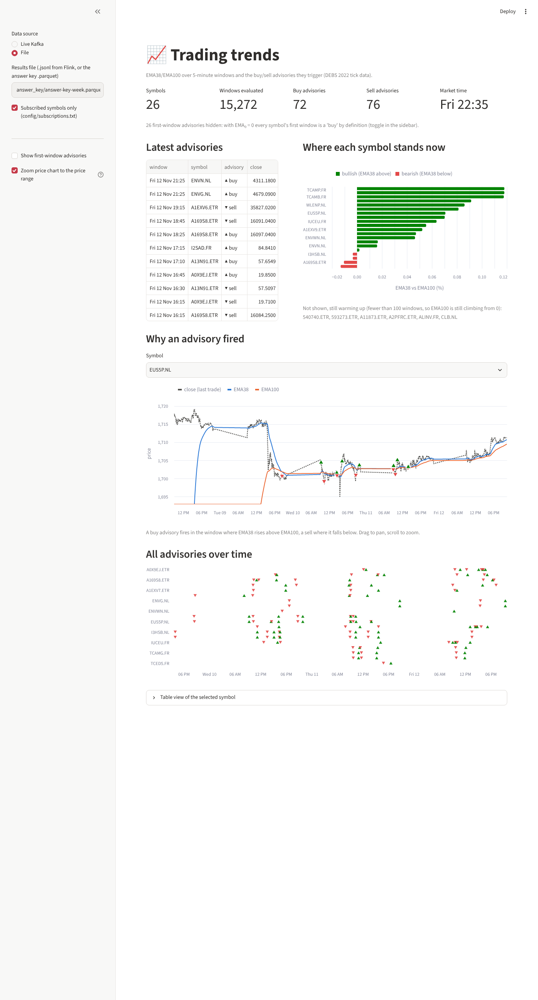
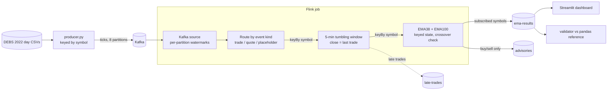

# Detecting Trading Trends in Financial Tick Data

CS-E4780 Scalable Systems and Data Management, course project (Aalto University, 2026).

A streaming system that replays a week of real tick data (DEBS 2022 Grand Challenge: 289 million
events, 5,502 symbols, Paris, Amsterdam and Frankfurt) through **Kafka** into **Apache Flink**. It
computes **EMA38 and EMA100 for every symbol in 5-minute tumbling windows** (Query 1) and emits
**buy/sell advisories on EMA crossovers** (Query 2). A **Streamlit dashboard** shows the results
(smart visualization). Every result is checked against an independent pandas reference.

**Report:** [`report/report.pdf`](report/report.pdf). Headline results (MacBook Air M5, Docker, details in
the report and in [`results/summary.md`](results/summary.md)):

- Full week (Mon to Fri, 59.4 M trades, 4,970 symbols): all 1,855,645 windows and 11,349 advisories match the reference.
- 1 to 8 TaskManager cores: 73.9 s down to 18.4 s, 3.2 M events/s, speedup 4.0 (3 repeats per point).
- Latency from window completion to result: median 93 to 256 ms with tuned settings at 20k to 100k events/s.

<picture>
  <source media="(prefers-color-scheme: dark)" srcset="docs/dashboard-dark.png">
  
</picture>

## Architecture



| Piece | Where | What it does |
|---|---|---|
| Producer | `producer/producer.py` | Replays day files (all events or trades only; any days, exchanges or time range) at full speed, a fixed rate, or N times market speed. Keyed by symbol, so each symbol's events stay in order. |
| Flink job | `flink-job/src/main/java/ssdm/` | `TradingJob` wires the pipeline. `TickParser` reads and classifies events. `LastTradeAggregate` finds the window close. `EmaProcessor` holds the EMA state and checks crossovers. `Ema` holds the maths. |
| Reference | `tools/reference.py` | The pandas answer-key logic, which runs on any input |
| Validator | `tools/validate.py` | Window-by-window comparison: windows, closes, EMAs, advisories |
| Answer key | `answer_key/answer-key-week.parquet` | The reference result for Mon to Fri (1.86M symbol-windows) |
| Dashboard | `dashboard/dashboard.py` | Live from Kafka, or from any results file |
| Experiments | `experiments/` | Scalability (1 to 8 cores), latency under load, out-of-order trade-off, analysis |

**Semantics** (project spec section 3): a window is `[k·5min, (k+1)·5min)` from midnight. Its close
is the last trade (`Last > 0`) by trading time, with ties broken by file position. EMA₀ = 0 for
each symbol, `EMAʲ = close·2/(1+j) + EMAʲ_prev·(1 − 2/(1+j))`. Buy when EMA38 crosses above EMA100,
sell when it crosses below (equations 1 to 4). A window with no trades doesn't update the EMA. Trades
stamped with the placeholder time `01:00:00.000` are counted and dropped, because their real time is unknown.

## Quick start: the self-checking demo (Docker, no data download)

```bash
docker compose --profile demo up -d --build
docker compose --profile demo logs -f verify      # ends with PASSED
```

This builds the images, replays a real excerpt of the data through Kafka into Flink, compares
Flink's output window by window with the pandas reference, and serves the dashboard at
http://localhost:8501 (Flink UI at http://localhost:8081). `DEMO_INPUT=synthetic` replays three
generated days (2.1M events) instead. Stop with `docker compose --profile demo down --volumes`.

**Running it on another machine** (Linux, Windows, macOS, prebuilt images, offline image file):
see [docs/TESTING.md](docs/TESTING.md).

## Quick start without Docker: check correctness in 2 minutes

Needs Java 11+, Maven and Python 3.10+. On Windows, use Git Bash.

```bash
python3 -m venv venv && source venv/bin/activate
pip install -r requirements.txt

./flink-job/run-local.sh analysis/test-slice.csv results/test-slice.jsonl
python -m tools.validate --flink results/test-slice.jsonl --csv analysis/test-slice.csv
# windows: reference 330 | Flink 330 | matched 330 | missing 0 | extra 0 ... PASSED
```

`run-local.sh` runs the real job inside an in-process Flink cluster, reading CSV directly. For a
harder test, generate synthetic stress data (long tail, out-of-order trades, quotes, placeholders):

```bash
python -m tools.synth -n 3000000 -o data/synthetic.csv
./flink-job/run-local.sh data/synthetic.csv results/synthetic.jsonl --parallelism 4
python -m tools.validate --flink results/synthetic.jsonl --csv data/synthetic.csv
```

GitHub Actions runs both on every push, plus the Docker demo on a clean Ubuntu machine and this
quick start on Windows (`.github/workflows/ci.yml`).

## Get the data

Download the trading data from Zenodo, [record 6382482](https://doi.org/10.5281/zenodo.6382482)
(CC BY-NC-SA 4.0). Put the day files in `data/` with these names:

```
data/debs2022-gc-trading-day-08-11-21.csv   ... data/debs2022-gc-trading-day-14-11-21.csv
```

`data/` is git-ignored. Saturday and Sunday contain no trades.

## Run the whole system (Docker)

Needs Docker Desktop (give it at least 6 CPUs and 8 GB) and the data in `data/`.

```bash
docker compose --profile app up -d --build
```

This builds two images, `ssdm-flink:1.0` (Flink 1.20 with the job inside) and `ssdm-python:1.0`
(producer, dashboard, tools). It then starts Kafka, creates the topics, starts a JobManager and a
TaskManager (4 task slots and no CPU cap by default), submits the job for the symbols in
`config/subscriptions.txt`, replays Monday to Friday, and serves:

- Flink UI: http://localhost:8081 (operator metrics `ticksTrade`, `ticksNonTrade`, `ticksPlaceholder`...)
- Dashboard: http://localhost:8501

Useful knobs (environment variables or `.env`): `TM_CPUS`, `TM_SLOTS`, `TM_MEMORY`, `PARALLELISM`,
`DAYS`, `SPEED` (for example `SPEED=60` replays an hour of market time per minute), `RATE` (events/s),
and `IMAGE_PREFIX` to run published images instead of building them.

| Command | Starts |
|---|---|
| `docker compose --profile demo up -d --build` | everything, replaying a bundled slice (or `DEMO_INPUT=synthetic`), then checks the output |
| `docker compose --profile app up -d --build` | everything, replaying the week from `./data` |
| `docker compose up -d --build` | only Kafka and Flink, which is what the experiment scripts use |

Step by step instead, for example to run the producer on the host:

```bash
docker compose up -d --build                       # Kafka + Flink + topics
docker compose exec jobmanager flink run -d /opt/ssdm/trading-job.jar \
    --subscriptions @/opt/ssdm/config/subscriptions.txt
python producer/producer.py --days 08-11-21 --speed 60
streamlit run dashboard/dashboard.py
```

### Job options

| Option | Default | Meaning |
|---|---|---|
| `--bootstrap` | `kafka:29092` | Kafka brokers |
| `--input-topic` / `--results-topic` / `--advisories-topic` / `--late-topic` | `ticks` / `ema-results` / `advisories` / `late-trades` | topics |
| `--subscriptions` | `all` | `all`, `A.FR,B.NL`, or `@file` (one symbol per line) |
| `--ooo-ms` | `5000` | how far out of order trades may arrive before they count as late |
| `--idle-ms` | `10000` | a partition that's quiet this long stops holding back the watermark |
| `--bounded` | off | stop after reading what was in the topic at start (experiments) |
| `--start` | `earliest` | or `latest` |
| `--buffer-timeout-ms`, `--watermark-interval-ms` | Flink defaults (100, 200) | latency tuning |
| `--checkpoint-ms` | off | enable checkpointing for exactly-once state |
| `--input-file` / `--output-file` | | file mode (no Kafka) |
| `--parallelism` | cluster default | for file mode; use `flink run -p N` on a cluster |

### Output records (`ema-results`, `advisories`)

```json
{"symbol":"A169S8.ETR","secType":"I","windowStart":1636358400000,"windowEnd":1636358700000,
 "close":16027.61,"trades":76,"ema38":821.93,"ema100":317.38,"firstWindow":true,"signal":"buy",
 "maxIngestTs":...,"firedTs":...,"emitTs":...}
```

Times are epoch milliseconds. Market time is stored as if it were UTC, so windows align with
midnight. `maxIngestTs`, `firedTs` and `emitTs` are wall-clock times used by the latency analysis.

## Correctness on the full week

```bash
./experiments/run_scalability.sh      # includes a full-week run and validation, see below
# or by hand:
python producer/producer.py --days weekdays
docker compose exec jobmanager flink run -d -p 4 /opt/ssdm/trading-job.jar --bounded
python -m tools.dump_topic ema-results results/week-flink.jsonl
python -m tools.validate --flink results/week-flink.jsonl --answer-key answer_key/answer-key-week.parquet
```

## Experiments

See [`experiments/README.md`](experiments/README.md). In short:

```bash
./experiments/run_scalability.sh    # 1, 2, 4 cores x 3 repeats by default; the report used CORES="1 2 3 4 5 6 7 8"
./experiments/run_latency.sh        # latency percentiles at several input rates
./experiments/run_ooo_sweep.sh      # out-of-order bound vs late trades vs correctness
python -m experiments.analyze       # -> results/figures/*.png, results/summary.md
```

## Repository layout

```
analysis/        data exploration and the original answer-key scripts (pandas), test slice
answer_key/      reference results (parquet)
config/          subscribed symbols
dashboard/       Streamlit dashboard (its light and dark theme is in .streamlit/config.toml)
docs/            how to run and check it on another machine (TESTING.md), screenshots
experiments/     experiment scripts and analysis
flink-job/       the Flink job (Flink 1.20.0, compiled for Java 11, runs on Java 17), Dockerfile, run-local.sh
producer/        Kafka producer
report/          the final report (report.tex, report.pdf), its figures and scripts, AI-use disclosure
results/         raw experiment output, summary.md and figures (RUN-NOTES.md says how each run was made)
scripts/         export-images.sh: pack the images into one file for another machine
tools/           shared tick reader, reference, validator, synthetic data, topic dump
```

## Troubleshooting

- **`NoResourceAvailableException`**: the job asks for more parallelism than the TaskManager has slots. Raise `TM_SLOTS` (and `TM_CPUS`), or lower `-p`.
- **No results after the producer finished**: the last windows only fire when the watermark passes them. The producer's end-of-stream marker does that, unless it ran with `--no-eos`.
- **Re-running against the same topic**: an old end-of-stream marker would make new data look late. Run `./create-topics.sh --reset` first (the experiment scripts already do).
- **Producer slow**: use `--events trades` (the default), and run it on the host rather than in Docker.
