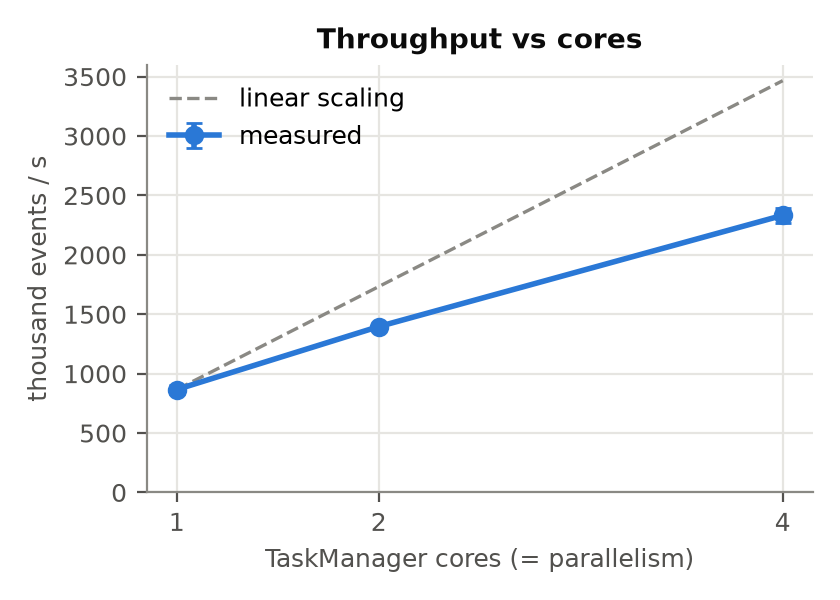
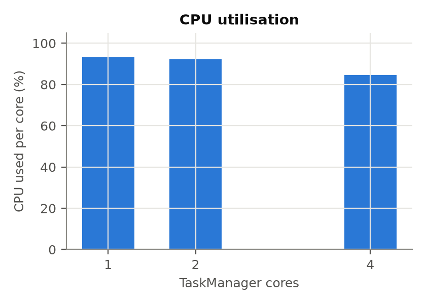
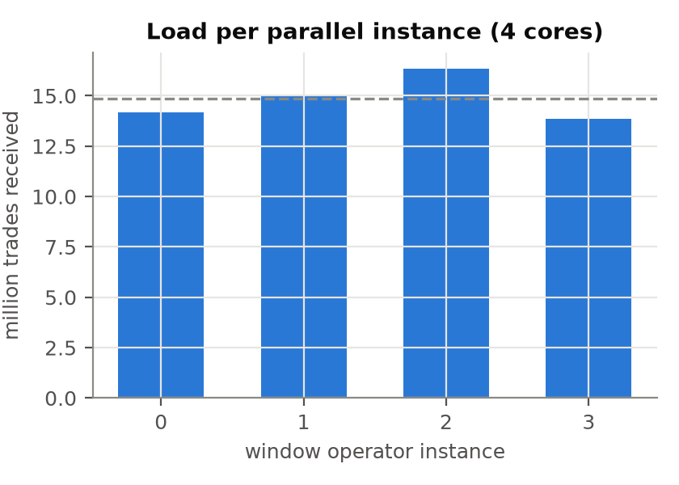
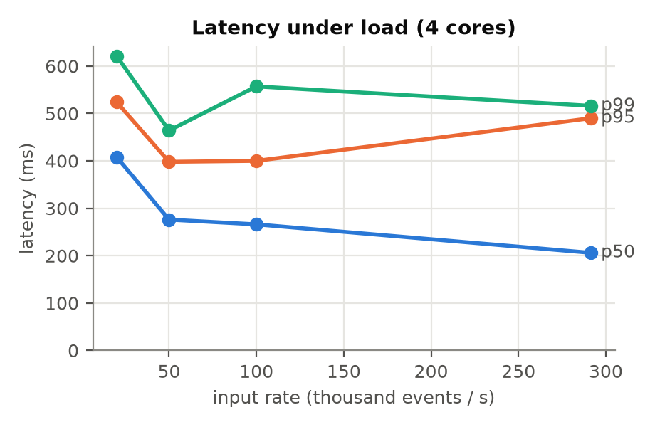
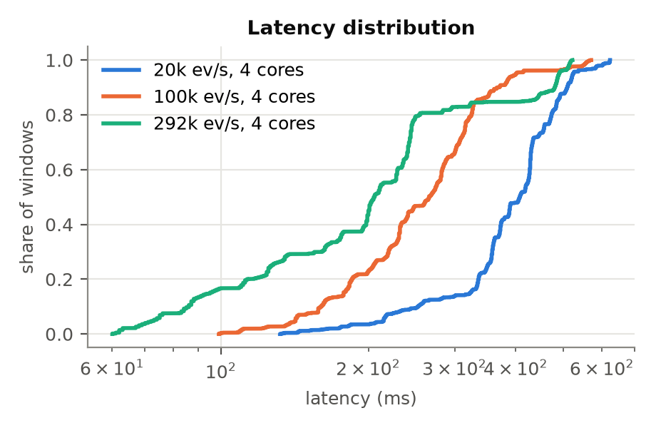
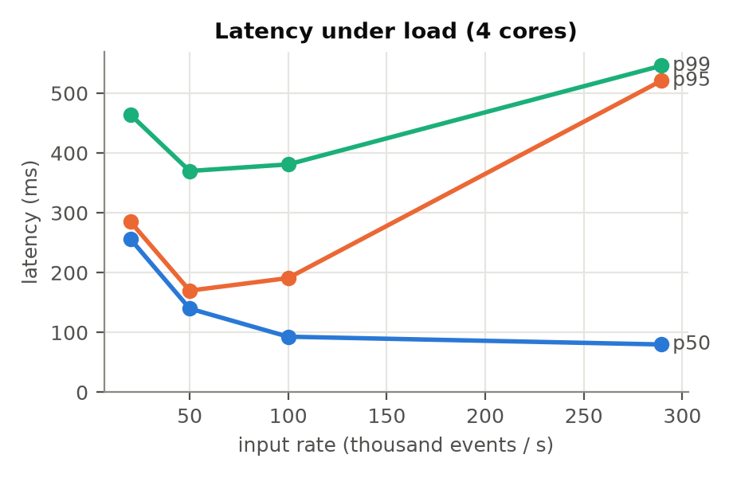
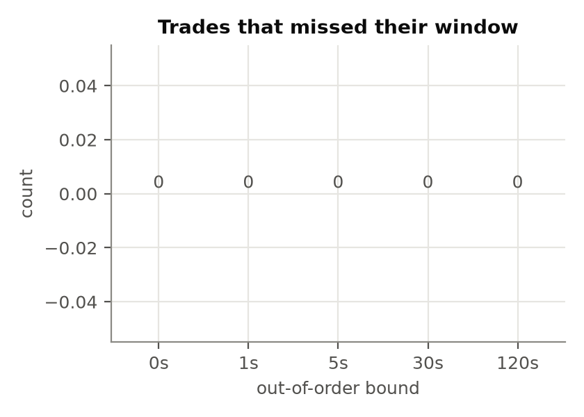

# Experiment results

Generated by `python -m experiments.analyze`. Numbers only; interpretation belongs in the report.

## Scalability (results/scalability/20261117-221652)

Input: 59,391,670 events (weekdays, trades, exchanges all). Host: Darwin arm64, Docker CPUs 10.

|   cores |   runs |   seconds_mean |   seconds_std |   throughput_mean |   throughput_std |   tm_cpu_percent |   speedup |   efficiency |   cpu_per_core_percent |
|--------:|-------:|---------------:|--------------:|------------------:|-----------------:|-----------------:|----------:|-------------:|-----------------------:|
|       1 |      3 |         68.632 |         3.054 |  866526           |          39313.6 |           93.184 |     1     |        1     |                 93.184 |
|       2 |      3 |         42.541 |         0.637 |       1.39631e+06 |          21098.8 |          184.219 |     1.613 |        0.807 |                 92.109 |
|       4 |      3 |         25.474 |         0.69  |       2.33257e+06 |          62810.7 |          337.959 |     2.694 |        0.674 |                 84.49  |

Window operator load at 4 cores: max/mean = 1.10 (1.00 = perfectly even). Per instance: [14185641, 15030141, 16328663, 13841719]

Correctness of the Kafka-path output against the reference:

```
{
 "windows_reference": 1855645,
 "windows_flink": 1855645,
 "windows_matched": 1855645,
 "windows_missing_in_flink": 0,
 "windows_extra_in_flink": 0,
 "symbols_reference": 4970,
 "symbols_flink": 4970,
 "windows_with_value_mismatch": 0,
 "max_rel_error": {
  "close": 2.2186711123604248e-16,
  "ema38": 5.5683518755818e-12,
  "ema100": 8.601891185941738e-12
 },
 "first_window_flag_mismatch": 0,
 "signals_all": {
  "expected": 11349,
  "matched": 11349,
  "missed": 0,
  "spurious": 0,
  "wrong_direction": 0
 },
 "signals_excluding_first_windows": {
  "expected": 6379,
  "matched": 6379,
  "missed": 0,
  "spurious": 0,
  "wrong_direction": 0
 },
 "passed": true
}
```





## Latency (results/latency/20261117-224744)

Latency = time from a window becoming complete (first event of the next window sent) to its EMA result being produced. wait = until the window fired; processing = after that.

|   cores |   target_rate |   achieved_rate |   windows |   latency_p50 |   latency_p95 |   latency_p99 |   wait_p50 |   wait_p95 |   wait_p99 |   processing_p50 |   processing_p95 |   processing_p99 |   latency_max |   advisory_latency_p99 |
|--------:|--------------:|----------------:|----------:|--------------:|--------------:|--------------:|-----------:|-----------:|-----------:|-----------------:|-----------------:|-----------------:|--------------:|-----------------------:|
|       4 |         20000 |           19997 |     96765 |           408 |           524 |           621 |        385 |        503 |        522 |                3 |              100 |              102 |           623 |                    510 |
|       4 |         50000 |           49980 |     96765 |           276 |           398 |           464 |        261 |        345 |        364 |                3 |              101 |              105 |           467 |                    394 |
|       4 |        100000 |           99940 |     96765 |           266 |           400 |           557 |        239 |        324 |        463 |                2 |               96 |              115 |           570 |                    521 |
|       4 |             0 |          291546 |     96765 |           206 |           490 |           516 |        198 |        422 |        462 |                4 |              139 |              203 |           522 |                    448 |




## Latency (results/latency/tuned)

Latency = time from a window becoming complete (first event of the next window sent) to its EMA result being produced. wait = until the window fired; processing = after that.

|   cores |   target_rate |   achieved_rate |   windows |   latency_p50 |   latency_p95 |   latency_p99 |   wait_p50 |   wait_p95 |   wait_p99 |   processing_p50 |   processing_p95 |   processing_p99 |   latency_max |   advisory_latency_p99 |
|--------:|--------------:|----------------:|----------:|--------------:|--------------:|--------------:|-----------:|-----------:|-----------:|-----------------:|-----------------:|-----------------:|--------------:|-----------------------:|
|       4 |         20000 |           19997 |     96765 |           256 |           285 |           464 |        253 |        279 |        463 |                3 |               10 |               46 |           468 |                    285 |
|       4 |         50000 |           49984 |     96765 |           140 |           170 |           370 |        137 |        161 |        332 |                3 |                8 |               34 |           452 |                    450 |
|       4 |        100000 |           99939 |     96765 |            93 |           191 |           381 |         89 |        123 |        301 |                2 |               35 |              115 |           396 |                    374 |
|       4 |             0 |          289400 |     96765 |            80 |           521 |           546 |         77 |        451 |        489 |                2 |              121 |              229 |           555 |                    447 |




## Out-of-order bound sweep (results/ooo-sweep/20261117-230210)

|   bound_ms |   seconds |   late_trades |   passed |   windows_wrong |   signals_missed_or_wrong |   signals_expected |
|-----------:|----------:|--------------:|---------:|----------------:|--------------------------:|-------------------:|
|          0 |      24   |             0 |        1 |               0 |                         0 |               4840 |
|       1000 |      25.1 |             0 |        1 |               0 |                         0 |               4840 |
|       5000 |      24.4 |             0 |        1 |               0 |                         0 |               4840 |
|      30000 |      24.9 |             0 |        1 |               0 |                         0 |               4840 |
|     120000 |      25.2 |             0 |        1 |               0 |                         0 |               4840 |



