# Experiment results

Generated by `python -m experiments.analyze`. Numbers only; interpretation belongs in the report.

## Scalability (results/scalability/20261124-132305-cores-1-8)

Input: 59,391,670 events (weekdays, trades, exchanges all). Host: Darwin arm64, Docker CPUs 10.

|   cores |   runs |   seconds_mean |   seconds_std |   throughput_mean |   throughput_std |   tm_cpu_percent |   speedup |   efficiency |   cpu_per_core_percent |
|--------:|-------:|---------------:|--------------:|------------------:|-----------------:|-----------------:|----------:|-------------:|-----------------------:|
|       1 |      1 |         68.566 |           nan |  866197           |              nan |           93.397 |     1     |        1     |                 93.397 |
|       2 |      1 |         42.631 |           nan |       1.39316e+06 |              nan |          188.926 |     1.608 |        0.804 |                 94.463 |
|       4 |      1 |         24.07  |           nan |       2.46746e+06 |              nan |          354.754 |     2.849 |        0.712 |                 88.688 |
|       6 |      1 |         20.339 |           nan |       2.92009e+06 |              nan |          471.483 |     3.371 |        0.562 |                 78.58  |
|       8 |      1 |         14.547 |           nan |       4.08274e+06 |              nan |          604.319 |     4.713 |        0.589 |                 75.54  |

Window operator load at 8 cores: max/mean = 1.15 (1.00 = perfectly even). Per instance: [7398806, 6786835, 7603495, 7426646, 8521959, 7806704, 7454359, 6387360]

Correctness of the Kafka-path output against the reference:

```
{
 "windows_reference": 1855645,
 "windows_flink": 1855645,
 "windows_matched": 1855645,
 "windows_missing_in_flink": 0,
 "windows_extra_in_flink": 0,
 "symbols_reference": 4970,
 "symbols_flink": 4970,
 "windows_with_value_mismatch": 0,
 "max_rel_error": {
  "close": 2.2186711123604248e-16,
  "ema38": 5.5683518755818e-12,
  "ema100": 8.601891185941738e-12
 },
 "first_window_flag_mismatch": 0,
 "signals_all": {
  "expected": 11349,
  "matched": 11349,
  "missed": 0,
  "spurious": 0,
  "wrong_direction": 0
 },
 "signals_excluding_first_windows": {
  "expected": 6379,
  "matched": 6379,
  "missed": 0,
  "spurious": 0,
  "wrong_direction": 0
 },
 "passed": true
}
```


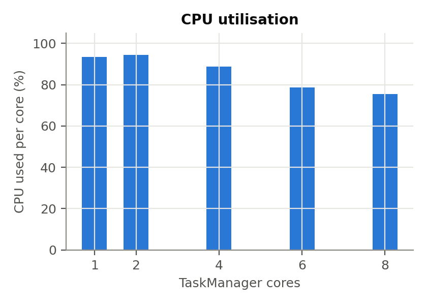
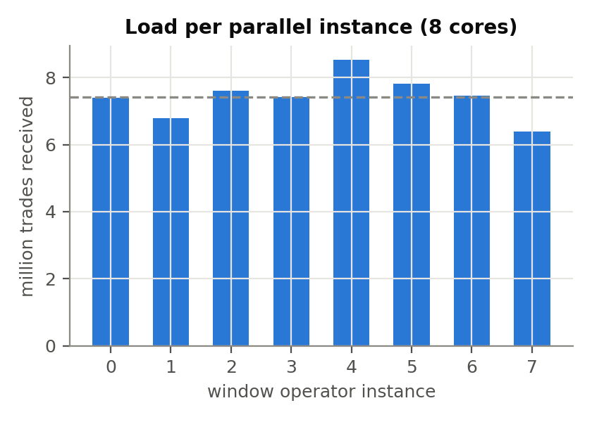

## Scalability (results/scalability/20261124-132305-all-events)

Input: 289,057,297 events (weekdays, all, exchanges all). Host: Darwin arm64, Docker CPUs 10.

|   cores |   runs |   seconds_mean |   seconds_std |   throughput_mean |   throughput_std |   tm_cpu_percent |   speedup |   efficiency |   cpu_per_core_percent |
|--------:|-------:|---------------:|--------------:|------------------:|-----------------:|-----------------:|----------:|-------------:|-----------------------:|
|       1 |      1 |        147.478 |           nan |       1.96e+06    |              nan |           94.488 |     1     |        1     |                 94.488 |
|       2 |      1 |         86.677 |           nan |       3.33488e+06 |              nan |          192.511 |     1.701 |        0.851 |                 96.256 |
|       4 |      1 |         55.379 |           nan |       5.21962e+06 |              nan |          366.489 |     2.663 |        0.666 |                 91.622 |

Window operator load at 4 cores: max/mean = 1.10 (1.00 = perfectly even). Per instance: [14185641, 15030141, 16328663, 13841719]

Correctness of the Kafka-path output against the reference:

```
{
 "windows_reference": 1855645,
 "windows_flink": 1855645,
 "windows_matched": 1855645,
 "windows_missing_in_flink": 0,
 "windows_extra_in_flink": 0,
 "symbols_reference": 4970,
 "symbols_flink": 4970,
 "windows_with_value_mismatch": 0,
 "max_rel_error": {
  "close": 2.2186711123604248e-16,
  "ema38": 5.5683518755818e-12,
  "ema100": 8.601891185941738e-12
 },
 "first_window_flag_mismatch": 0,
 "signals_all": {
  "expected": 11349,
  "matched": 11349,
  "missed": 0,
  "spurious": 0,
  "wrong_direction": 0
 },
 "signals_excluding_first_windows": {
  "expected": 6379,
  "matched": 6379,
  "missed": 0,
  "spurious": 0,
  "wrong_direction": 0
 },
 "passed": true
}
```

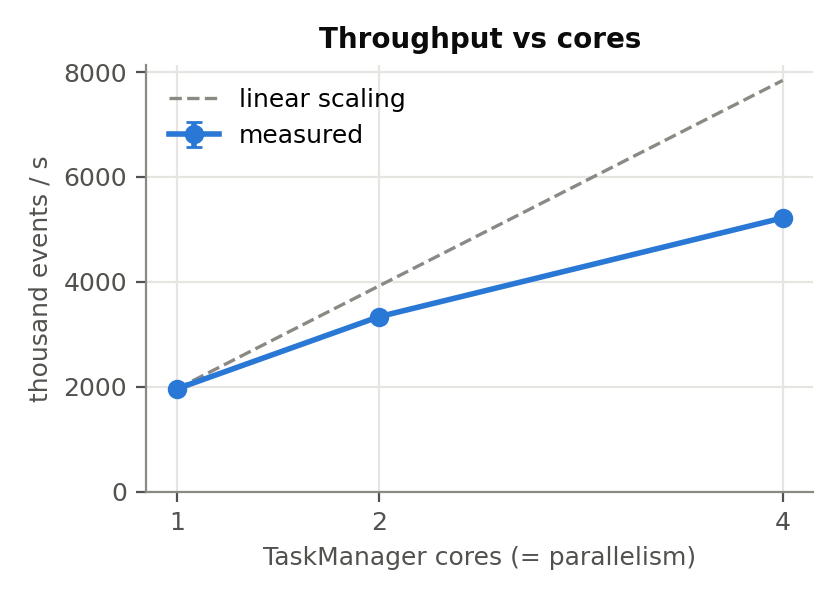
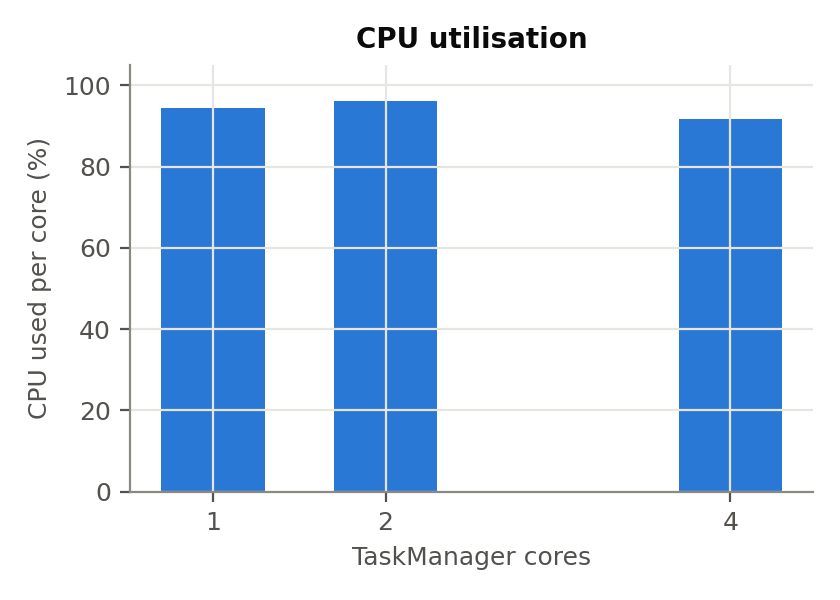


## Scalability (results/scalability/20261124-132305-FR)

Input: 21,367,417 events (weekdays, trades, exchanges FR). Host: Darwin arm64, Docker CPUs 10.

|   cores |   runs |   seconds_mean |   seconds_std |   throughput_mean |   throughput_std |   tm_cpu_percent |   speedup |   efficiency |   cpu_per_core_percent |
|--------:|-------:|---------------:|--------------:|------------------:|-----------------:|-----------------:|----------:|-------------:|-----------------------:|
|       1 |      1 |         31.791 |           nan |  672122           |              nan |           88.741 |     1     |        1     |                 88.741 |
|       2 |      1 |         19.567 |           nan |       1.09201e+06 |              nan |          170.8   |     1.625 |        0.812 |                 85.4   |
|       4 |      1 |         11.33  |           nan |       1.88592e+06 |              nan |          261.17  |     2.806 |        0.701 |                 65.292 |

Window operator load at 4 cores: max/mean = 1.05 (1.00 = perfectly even). Per instance: [5583486, 4868856, 5617497, 5293207]

Correctness of the Kafka-path output against the reference:

```
{
 "windows_reference": 1043637,
 "windows_flink": 1043637,
 "windows_matched": 1043637,
 "windows_missing_in_flink": 0,
 "windows_extra_in_flink": 0,
 "symbols_reference": 2285,
 "symbols_flink": 2285,
 "windows_with_value_mismatch": 0,
 "max_rel_error": {
  "close": 2.2186711123604248e-16,
  "ema38": 5.5683518755818e-12,
  "ema100": 8.601891185941738e-12
 },
 "first_window_flag_mismatch": 0,
 "signals_all": {
  "expected": 6049,
  "matched": 6049,
  "missed": 0,
  "spurious": 0,
  "wrong_direction": 0
 },
 "signals_excluding_first_windows": {
  "expected": 3764,
  "matched": 3764,
  "missed": 0,
  "spurious": 0,
  "wrong_direction": 0
 },
 "passed": true
}
```

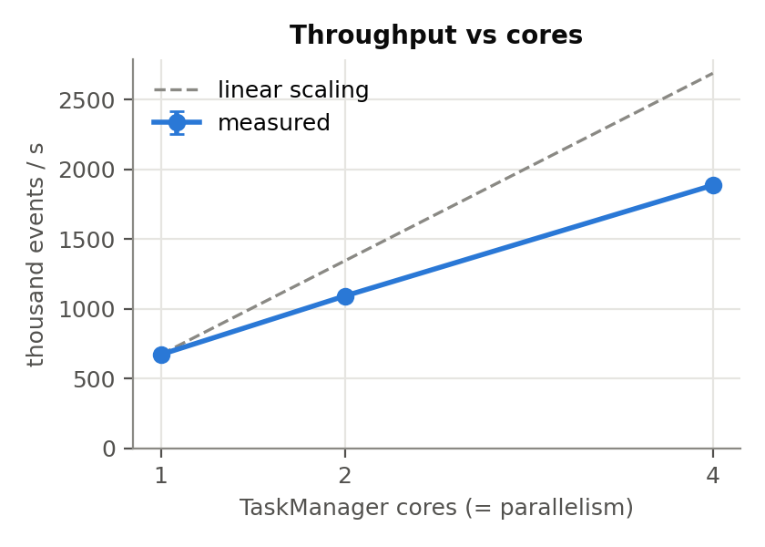
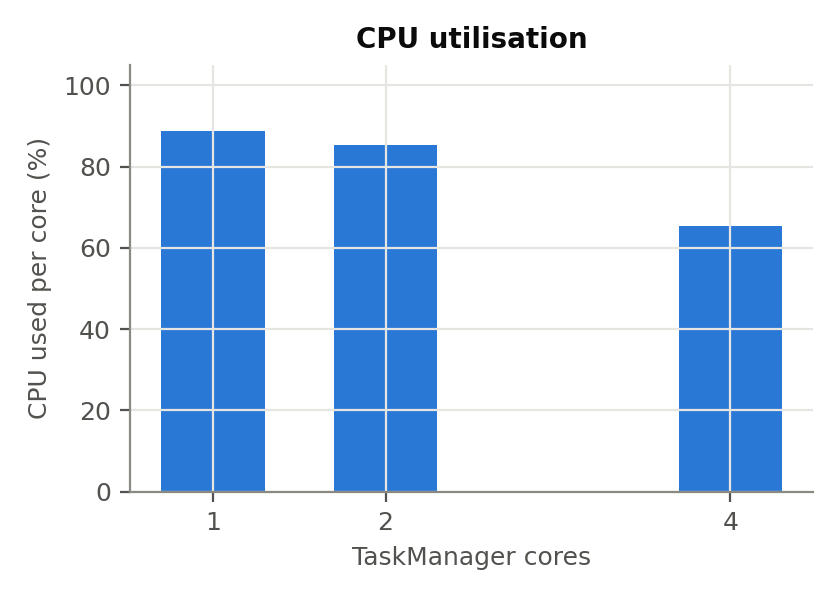
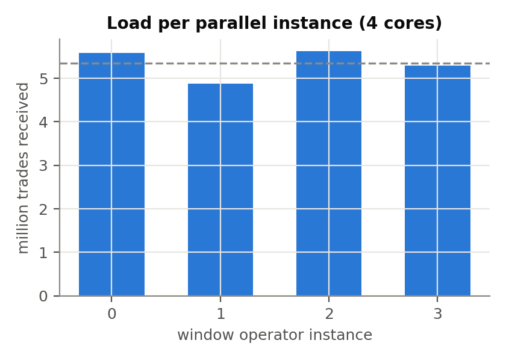

## Scalability (results/scalability/20261124-132305-NL)

Input: 6,028,250 events (weekdays, trades, exchanges NL). Host: Darwin arm64, Docker CPUs 10.

|   cores |   runs |   seconds_mean |   seconds_std |   throughput_mean |   throughput_std |   tm_cpu_percent |   speedup |   efficiency |   cpu_per_core_percent |
|--------:|-------:|---------------:|--------------:|------------------:|-----------------:|-----------------:|----------:|-------------:|-----------------------:|
|       1 |      1 |         13.185 |           nan |  457205           |              nan |           73.848 |     1     |        1     |                 73.848 |
|       2 |      1 |          9.131 |           nan |  660196           |              nan |          182.308 |     1.444 |        0.722 |                 91.154 |
|       4 |      1 |          5.001 |           nan |       1.20541e+06 |              nan |          167.888 |     2.636 |        0.659 |                 41.972 |

Window operator load at 4 cores: max/mean = 1.07 (1.00 = perfectly even). Per instance: [1358377, 1474047, 1615141, 1579550]

Correctness of the Kafka-path output against the reference:

```
{
 "windows_reference": 255249,
 "windows_flink": 255249,
 "windows_matched": 255249,
 "windows_missing_in_flink": 0,
 "windows_extra_in_flink": 0,
 "symbols_reference": 559,
 "symbols_flink": 559,
 "windows_with_value_mismatch": 0,
 "max_rel_error": {
  "close": 2.1189989733988436e-16,
  "ema38": 3.783649605446027e-13,
  "ema100": 5.976934446486823e-13
 },
 "first_window_flag_mismatch": 0,
 "signals_all": {
  "expected": 1409,
  "matched": 1409,
  "missed": 0,
  "spurious": 0,
  "wrong_direction": 0
 },
 "signals_excluding_first_windows": {
  "expected": 850,
  "matched": 850,
  "missed": 0,
  "spurious": 0,
  "wrong_direction": 0
 },
 "passed": true
}
```

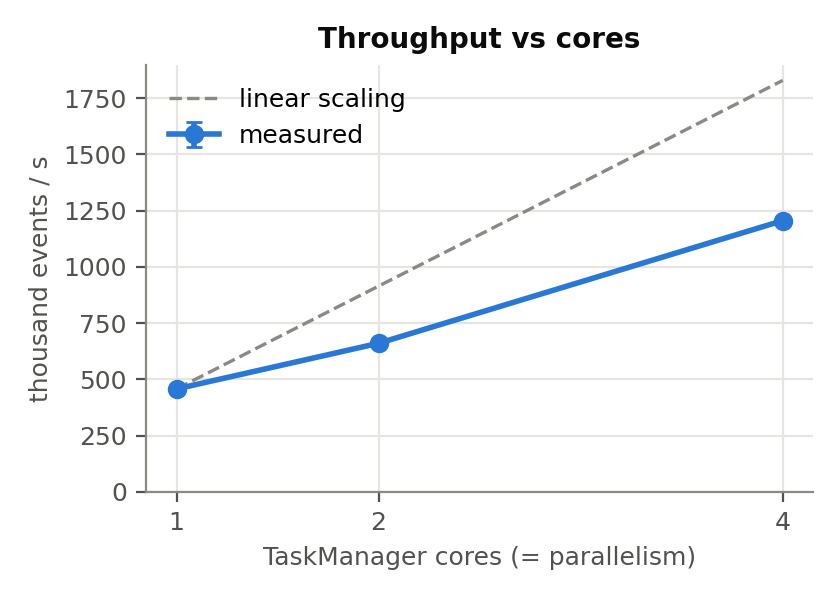
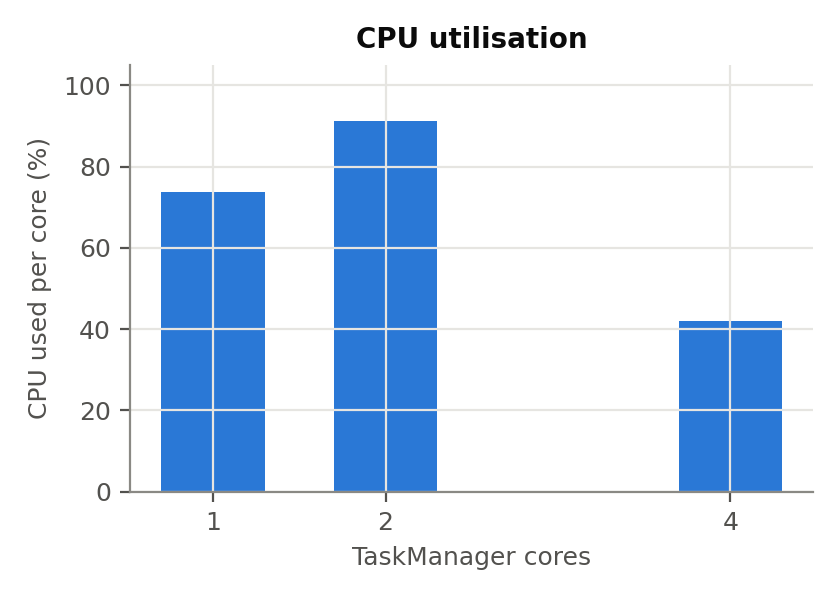
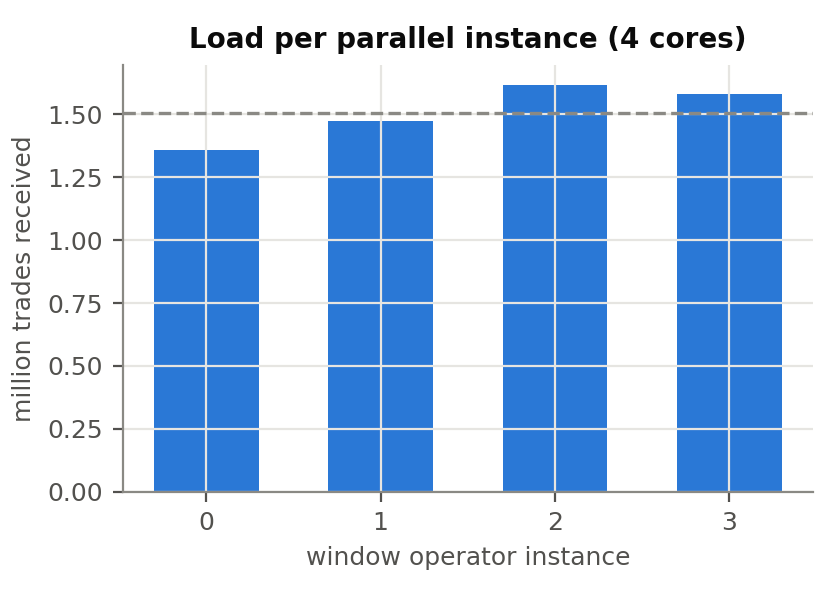

## Scalability (results/scalability/20261124-132305-ETR)

Input: 31,996,003 events (weekdays, trades, exchanges ETR). Host: Darwin arm64, Docker CPUs 10.

|   cores |   runs |   seconds_mean |   seconds_std |   throughput_mean |   throughput_std |   tm_cpu_percent |   speedup |   efficiency |   cpu_per_core_percent |
|--------:|-------:|---------------:|--------------:|------------------:|-----------------:|-----------------:|----------:|-------------:|-----------------------:|
|       1 |      1 |         38.997 |           nan |  820473           |              nan |           94.047 |     1     |        1     |                 94.047 |
|       2 |      1 |         22.152 |           nan |       1.44438e+06 |              nan |          153.345 |     1.76  |        0.88  |                 76.672 |
|       4 |      1 |         13.842 |           nan |       2.31152e+06 |              nan |          280.057 |     2.817 |        0.704 |                 70.014 |

Window operator load at 4 cores: max/mean = 1.14 (1.00 = perfectly even). Per instance: [7243778, 8687238, 9096025, 6968962]

Correctness of the Kafka-path output against the reference:

```
{
 "windows_reference": 556759,
 "windows_flink": 556759,
 "windows_matched": 556759,
 "windows_missing_in_flink": 0,
 "windows_extra_in_flink": 0,
 "symbols_reference": 2126,
 "symbols_flink": 2126,
 "windows_with_value_mismatch": 0,
 "max_rel_error": {
  "close": 2.2186711123604248e-16,
  "ema38": 1.0917811970672123e-12,
  "ema100": 1.296201672600987e-12
 },
 "first_window_flag_mismatch": 0,
 "signals_all": {
  "expected": 3891,
  "matched": 3891,
  "missed": 0,
  "spurious": 0,
  "wrong_direction": 0
 },
 "signals_excluding_first_windows": {
  "expected": 1765,
  "matched": 1765,
  "missed": 0,
  "spurious": 0,
  "wrong_direction": 0
 },
 "passed": true
}
```

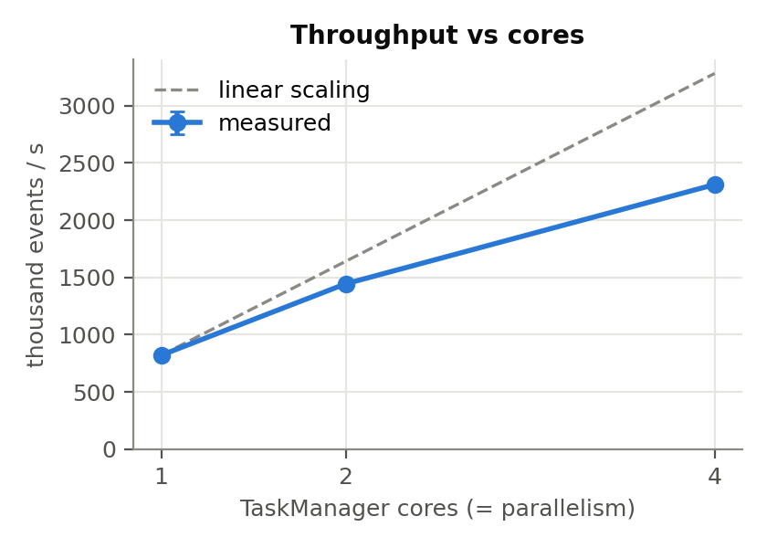
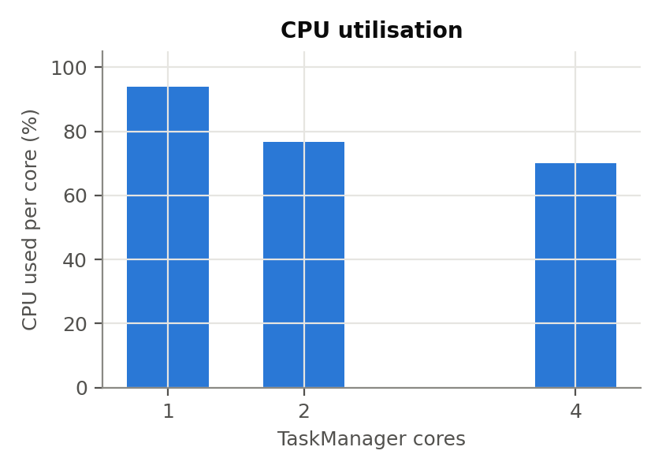
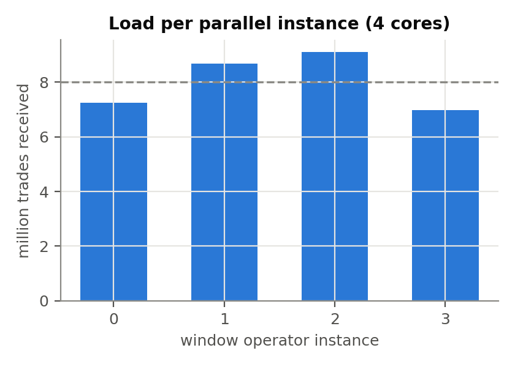

## Scalability across runs

| run                        | events_kind   | exchanges   |    events |   cores |   seconds_mean |   throughput_mean |   speedup |   tm_cpu_percent |
|:---------------------------|:--------------|:------------|----------:|--------:|---------------:|------------------:|----------:|-----------------:|
| 20261124-132305-cores-1-8  | trades        | all         |  59391670 |       1 |         68.566 |  866197           |     1     |           93.397 |
| 20261124-132305-cores-1-8  | trades        | all         |  59391670 |       2 |         42.631 |       1.39316e+06 |     1.608 |          188.926 |
| 20261124-132305-cores-1-8  | trades        | all         |  59391670 |       4 |         24.07  |       2.46746e+06 |     2.849 |          354.754 |
| 20261124-132305-cores-1-8  | trades        | all         |  59391670 |       6 |         20.339 |       2.92009e+06 |     3.371 |          471.483 |
| 20261124-132305-cores-1-8  | trades        | all         |  59391670 |       8 |         14.547 |       4.08274e+06 |     4.713 |          604.319 |
| 20261124-132305-all-events | all           | all         | 289057297 |       1 |        147.478 |       1.96e+06    |     1     |           94.488 |
| 20261124-132305-all-events | all           | all         | 289057297 |       2 |         86.677 |       3.33488e+06 |     1.701 |          192.511 |
| 20261124-132305-all-events | all           | all         | 289057297 |       4 |         55.379 |       5.21962e+06 |     2.663 |          366.489 |
| 20261124-132305-FR         | trades        | FR          |  21367417 |       1 |         31.791 |  672122           |     1     |           88.741 |
| 20261124-132305-FR         | trades        | FR          |  21367417 |       2 |         19.567 |       1.09201e+06 |     1.625 |          170.8   |
| 20261124-132305-FR         | trades        | FR          |  21367417 |       4 |         11.33  |       1.88592e+06 |     2.806 |          261.17  |
| 20261124-132305-NL         | trades        | NL          |   6028250 |       1 |         13.185 |  457205           |     1     |           73.848 |
| 20261124-132305-NL         | trades        | NL          |   6028250 |       2 |          9.131 |  660196           |     1.444 |          182.308 |
| 20261124-132305-NL         | trades        | NL          |   6028250 |       4 |          5.001 |       1.20541e+06 |     2.636 |          167.888 |
| 20261124-132305-ETR        | trades        | ETR         |  31996003 |       1 |         38.997 |  820473           |     1     |           94.047 |
| 20261124-132305-ETR        | trades        | ETR         |  31996003 |       2 |         22.152 |       1.44438e+06 |     1.76  |          153.345 |
| 20261124-132305-ETR        | trades        | ETR         |  31996003 |       4 |         13.842 |       2.31152e+06 |     2.817 |          280.057 |

## Latency (results/latency/20261117-224744)

Latency = time from a window becoming complete (first event of the next window sent) to its EMA result being produced. wait = until the window fired; processing = after that.

|   cores |   target_rate |   achieved_rate |   windows |   latency_p50 |   latency_p95 |   latency_p99 |   wait_p50 |   wait_p95 |   wait_p99 |   processing_p50 |   processing_p95 |   processing_p99 |   latency_max |   advisory_latency_p99 |
|--------:|--------------:|----------------:|----------:|--------------:|--------------:|--------------:|-----------:|-----------:|-----------:|-----------------:|-----------------:|-----------------:|--------------:|-----------------------:|
|       4 |         20000 |           19997 |     96765 |           408 |           524 |           621 |        385 |        503 |        522 |                3 |              100 |              102 |           623 |                    510 |
|       4 |         50000 |           49980 |     96765 |           276 |           398 |           464 |        261 |        345 |        364 |                3 |              101 |              105 |           467 |                    394 |
|       4 |        100000 |           99940 |     96765 |           266 |           400 |           557 |        239 |        324 |        463 |                2 |               96 |              115 |           570 |                    521 |
|       4 |             0 |          291546 |     96765 |           206 |           490 |           516 |        198 |        422 |        462 |                4 |              139 |              203 |           522 |                    448 |


## Latency (results/latency/tuned)

Latency = time from a window becoming complete (first event of the next window sent) to its EMA result being produced. wait = until the window fired; processing = after that.

|   cores |   target_rate |   achieved_rate |   windows |   latency_p50 |   latency_p95 |   latency_p99 |   wait_p50 |   wait_p95 |   wait_p99 |   processing_p50 |   processing_p95 |   processing_p99 |   latency_max |   advisory_latency_p99 |
|--------:|--------------:|----------------:|----------:|--------------:|--------------:|--------------:|-----------:|-----------:|-----------:|-----------------:|-----------------:|-----------------:|--------------:|-----------------------:|
|       4 |         20000 |           19997 |     96765 |           256 |           285 |           464 |        253 |        279 |        463 |                3 |               10 |               46 |           468 |                    285 |
|       4 |         50000 |           49984 |     96765 |           140 |           170 |           370 |        137 |        161 |        332 |                3 |                8 |               34 |           452 |                    450 |
|       4 |        100000 |           99939 |     96765 |            93 |           191 |           381 |         89 |        123 |        301 |                2 |               35 |              115 |           396 |                    374 |
|       4 |             0 |          289400 |     96765 |            80 |           521 |           546 |         77 |        451 |        489 |                2 |              121 |              229 |           555 |                    447 |


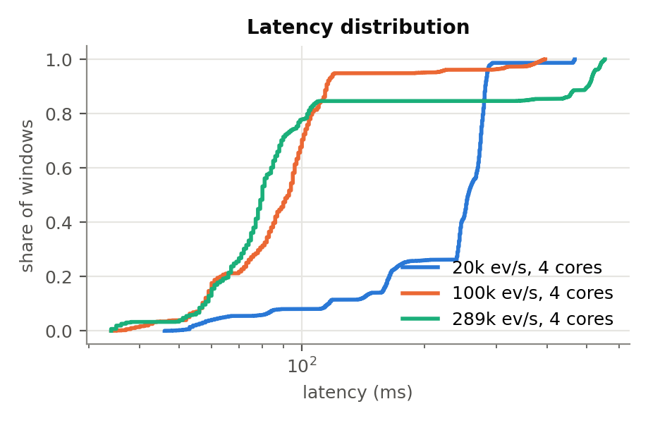

## Latency (results/latency/20261124-132305-ooo0)

Latency = time from a window becoming complete (first event of the next window sent) to its EMA result being produced. wait = until the window fired; processing = after that.

|   cores |   target_rate |   achieved_rate |   windows |   latency_p50 |   latency_p95 |   latency_p99 |   wait_p50 |   wait_p95 |   wait_p99 |   processing_p50 |   processing_p95 |   processing_p99 |   latency_max |   advisory_latency_p99 |
|--------:|--------------:|----------------:|----------:|--------------:|--------------:|--------------:|-----------:|-----------:|-----------:|-----------------:|-----------------:|-----------------:|--------------:|-----------------------:|
|       4 |         20000 |           19998 |     96765 |           237 |           352 |           422 |        224 |        316 |        349 |                3 |              101 |            105   |           454 |                    362 |
|       4 |         50000 |           49993 |     96765 |           230 |           327 |           364 |        223 |        290 |        310 |                3 |              100 |            102   |           402 |                    359 |
|       4 |        100000 |           99985 |     96765 |           232 |           308 |           369 |        222 |        289 |        304 |                2 |               85 |            100   |           386 |                    305 |
|       4 |             0 |          313135 |     96765 |           252 |           466 |           478 |        239 |        419 |        437 |                4 |               97 |            133.4 |           505 |                    360 |

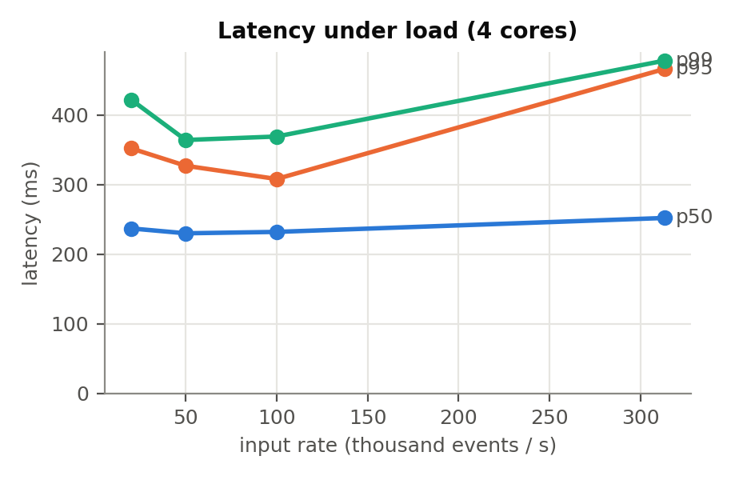
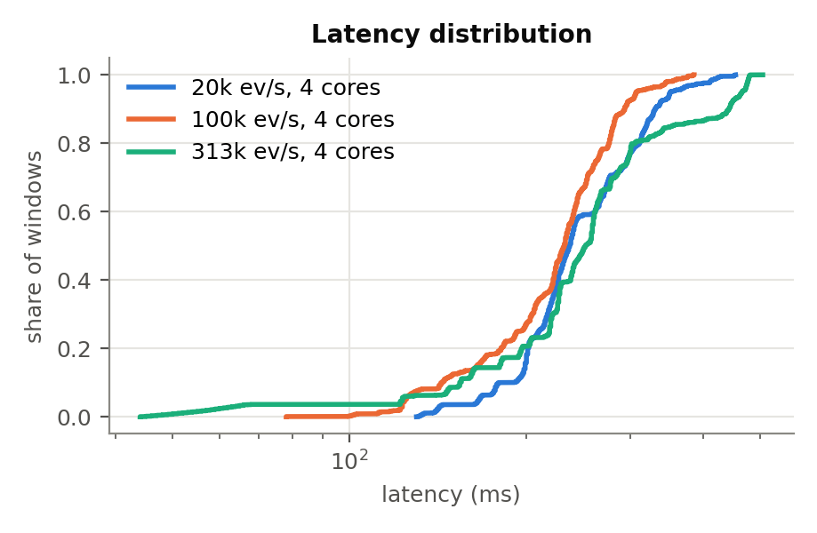

## Out-of-order bound sweep (results/ooo-sweep/20261117-230210)

|   bound_ms |   seconds |   late_trades |   passed |   windows_wrong |   signals_missed_or_wrong |   signals_expected |
|-----------:|----------:|--------------:|---------:|----------------:|--------------------------:|-------------------:|
|          0 |      24   |             0 |        1 |               0 |                         0 |               4840 |
|       1000 |      25.1 |             0 |        1 |               0 |                         0 |               4840 |
|       5000 |      24.4 |             0 |        1 |               0 |                         0 |               4840 |
|      30000 |      24.9 |             0 |        1 |               0 |                         0 |               4840 |
|     120000 |      25.2 |             0 |        1 |               0 |                         0 |               4840 |


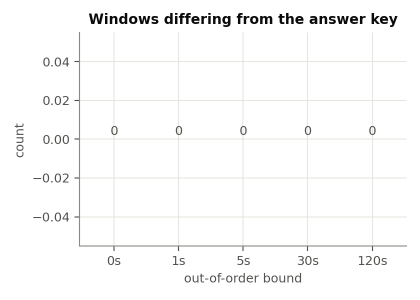
